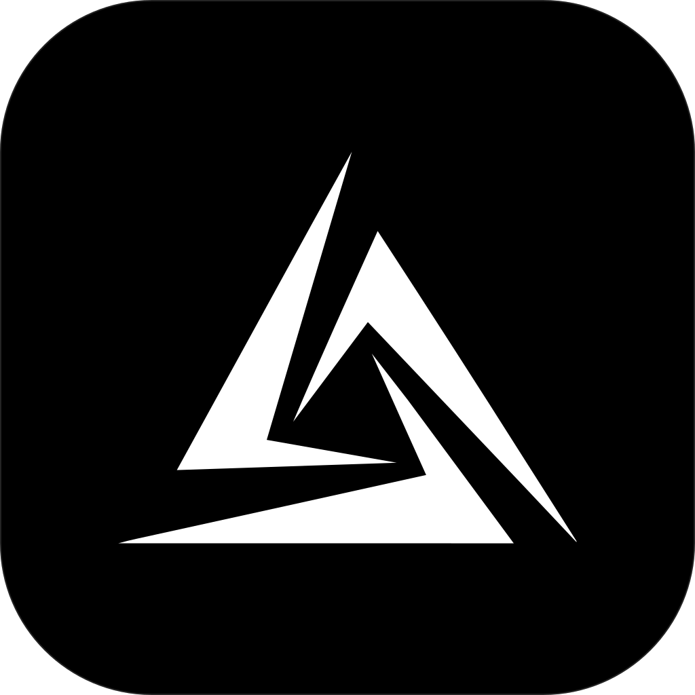
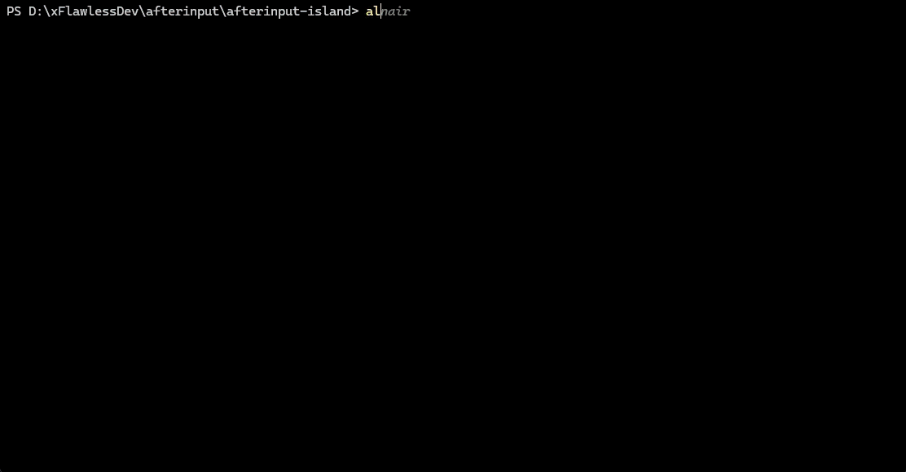

<div align="center">



<h1>Alnair (<code>alnair</code>)</h1>

<h3>🕸️ Graph engineering, built in</h3>

<p><code>/graph</code> turns one objective into a dependency graph of
autonomous, self-verifying agent loops — planned, parallelized,
adversarially verified, and merged back, end to end.</p>

<p>When the harness gets it wrong, it writes the lesson down. The next session
in that repo starts with what already failed — so it doesn't fail the same way
twice.</p>

**Alnair** is a coding agent that lives in your terminal. It reads the repo,
writes the patch, runs the tests, and keeps going while you do something else.
Full-screen, headless in CI with `-p`, or docked in your editor over ACP.

**Already paying for Claude Pro/Max, ChatGPT Plus/Pro, GitHub Copilot, or
Grok? Sign in and use it.** No API key, no second bill. Rather bring your own
key? OpenAI, Anthropic, Google, DeepSeek, Groq, Moonshot and
[two dozen more](#providers-and-api-keys) are wired in.

[Installation](#installation) ·
[Graph engineering](#graph-engineering) ·
[Lessons](#lessons) ·
[Providers and API keys](#providers-and-api-keys) ·
[Building from source](#building-from-source) ·
[One identity](#one-identity-no-coexistence-shims) ·
[License](#license)



</div>

---

## Installation

```sh
# macOS / Linux
curl -fsSL https://raw.githubusercontent.com/xFlawlessDev/alnair-harness/master/install.sh | bash
```

```powershell
# Windows PowerShell
irm https://raw.githubusercontent.com/xFlawlessDev/alnair-harness/master/install.ps1 | iex
```

```sh
alnair connect   # pick a provider, sign in — or disconnect one
alnair           # go
```

Single file, no runtime. macOS and Linux on arm64/x86_64, Windows on x86_64,
checksummed against the release's `SHA256SUMS`. `alnair update` handles upgrades.

## Graph engineering

Every other agent runs a loop: think, act, repeat — one thread, one thing at a
time. `/graph` runs a dependency graph instead. Work that doesn't block other
work happens at the same time, in separate worktrees, and nothing merges until
something else has tried to tear it apart.

```
/graph <objective> [--budget <tokens>]   # decompose + run fully autonomously
/graph status                            # node tree, budget, current work
/graph show                              # box-drawing DAG view
/graph pause | resume [--budget <n>]     # halt / continue (budget top-up)
/graph clear                             # abandon the graph
```

One command runs the whole thing, start to finish:

- A planner breaks your objective into a dependency DAG, then validates it.
- Independent nodes fan out as parallel workers, each in its own git worktree.
- Every node has to get past an adversarial verifier before it merges back.
- Find something out of scope? Say `DISCOVERED:` and the graph replans —
  append-only, so nothing already agreed on gets rewritten.
- Between passes, a topology optimizer drops dependencies that were never real.
- A final node re-checks the *whole* objective before the graph is allowed to
  call itself done.

State lives in `.alnair/graph.jsonl`, next to your code. Close the laptop, come
back tomorrow, `/graph resume`. A teammate can pick it up from the same file.

On by default. `ALNAIR_GRAPH=0` turns it off; `ALNAIR_GRAPH_CONCURRENCY` (default
3) controls how many nodes run at once.

## Lessons

When a goal keeps failing the same way, Alnair already stops and works out
*why* — then throws the answer away when the goal ends. Lessons keep it.

A lesson records what the harness itself got wrong in this repository and what
fixed it. It is written when the goal strategist restructures a stuck goal, and
when a `/graph` node is archived after a retry. The next session in the same
repository starts with the three newest, marked as advisory notes about how the
harness worked here — not as facts about your code.

```
/lessons              # what has been captured for this workspace
/lessons clear        # delete them
```

You will see them as a small block at the top of a new session:

```
<harness-lessons>
## Lessons from earlier sessions in this workspace

These are notes about how the harness worked here, not facts about the code.
Apply one only when the situation matches.

### Verification gaps keep reopening after a partial fix
Restructure the unit under test rather than patching the symptom; split the
tangled module first. (component: workflow)
</harness-lessons>
```

Three properties worth knowing, because they are what make this safe to leave on:

- **Nothing captured, nothing injected.** An empty store changes your prompt by
  zero bytes. A workspace that has never produced a lesson behaves exactly as
  it did before.
- **It lives in `~/.alnair/lessons/`, never in your repo.** A file that is read
  into context automatically is a file a hostile repository could use to steer
  every future session in it. Yours stays outside version control.
- **It is a plain Markdown file you can edit.** Delete any entry you disagree
  with in `~/.alnair/lessons/<workspace>/LESSONS.md`; that is the escape hatch.

On by default. `ALNAIR_LESSONS=0` turns it off, and `[lessons]` in
`config.toml` tunes the caps:

```toml
[lessons]
enabled = true          # capture and injection
max_entries = 50        # kept on disk, oldest dropped
inject_max = 3          # entries in the first-turn block
inject_max_chars = 400  # per entry
```

Edits apply to a running session, so turning capture off mid-goal takes effect
on the next strategist pass.

## Providers and API keys

29 platforms ship compiled in: 5 you sign into, 24 you hand a key. Anything
else is an endpoint you declare yourself ([your own endpoint](#your-own-endpoint)).

**Sign in with a subscription you already pay for.** Run `alnair connect` and
pick. Each provider's token is stored under its own key, and one provider's
credentials are never sent to another.

| Platform id      | Provider                  | Sign-in                                     |
| ---------------- | ------------------------- | ------------------------------------------- |
| `kimi-code`      | Kimi Code                 | Subscription OAuth (device code)            |
| `claude-pro-max` | Claude Pro/Max            | Subscription OAuth (browser, PKCE)          |
| `openai-codex`   | ChatGPT Plus/Pro (Codex)  | Subscription OAuth (browser, PKCE)          |
| `github-copilot` | GitHub Copilot            | Subscription OAuth (device code)            |
| `xai-grok`       | xAI Grok                  | Subscription OAuth (device code)            |

You get whatever models your plan actually serves — the list is fetched at
sign-in, not hardcoded. (ChatGPT/Codex is the exception: its backend publishes
no model endpoint, so those four are compiled in.)

**API-key providers.** Export the env var, or drop the key in
`~/.alnair/config.toml`. Keys are never logged.

| Provider                  | Platform id            | API key env                                     |
| ------------------------- | ---------------------- | ----------------------------------------------- |
| Moonshot (moonshot.cn)    | `moonshot-cn`          | `ALNAIR_MOONSHOT_CN_API_KEY` (or `ALNAIR_MOONSHOT_API_KEY`) |
| Moonshot (moonshot.ai)    | `moonshot-ai`          | `ALNAIR_MOONSHOT_AI_API_KEY` (or `ALNAIR_MOONSHOT_API_KEY`) |
| OpenAI                    | `openai`               | `OPENAI_API_KEY`                                |
| Anthropic                 | `anthropic`            | `ANTHROPIC_API_KEY`                             |
| DeepSeek                  | `deepseek`             | `DEEPSEEK_API_KEY`                              |
| Groq                      | `groq`                 | `GROQ_API_KEY`                                  |
| Mistral                   | `mistral`              | `MISTRAL_API_KEY`                               |
| Fireworks AI              | `fireworks`            | `FIREWORKS_API_KEY`                             |
| Google Gemini             | `google`               | `GEMINI_API_KEY`                                |
| OpenRouter                | `openrouter`           | `OPENROUTER_API_KEY`                            |
| Together AI               | `together`             | `TOGETHER_API_KEY`                              |
| Cerebras                  | `cerebras`             | `CEREBRAS_API_KEY`                              |
| NVIDIA NIM                | `nvidia`               | `NVIDIA_API_KEY`                                |
| Vercel AI Gateway         | `vercel-ai-gateway`    | `AI_GATEWAY_API_KEY`                            |
| xAI (Grok)                | `xai`                  | `XAI_API_KEY`                                   |
| Qwen Token Plan           | `qwen-token-plan`      | `QWEN_TOKEN_PLAN_API_KEY`                       |
| Qwen Token Plan (China)   | `qwen-token-plan-cn`   | `QWEN_TOKEN_PLAN_CN_API_KEY`                    |
| Kimi For Coding           | `kimi-coding`          | `KIMI_API_KEY`                                  |
| Z.AI                      | `zai`                  | `ZAI_API_KEY`                                   |
| Z.AI Coding (China)       | `zai-coding-cn`        | `ZAI_CODING_CN_API_KEY`                         |
| Xiaomi MiMo               | `xiaomi`               | `XIAOMI_API_KEY`                                |
| Xiaomi Token Plan (China) | `xiaomi-token-plan-cn` | `XIAOMI_TOKEN_PLAN_CN_API_KEY`                  |
| MiniMax                   | `minimax`              | `MINIMAX_API_KEY`                               |
| MiniMax (China)           | `minimax-cn`           | `MINIMAX_CN_API_KEY`                            |

```sh
export OPENAI_API_KEY=sk-...
export XAI_API_KEY=xai-...
```

```toml
# ~/.alnair/config.toml
[platforms.openai]
api_key = "sk-..."

[platforms.xai]
api_key = "xai-..."
```

### Your own endpoint

Custom providers can use OpenAI Chat Completions, OpenAI Responses, or Anthropic
Messages. In `alnair`, open `/connect` (or the welcome picker) and pick
**Custom provider (OpenAI Chat Completions compatible)**,
**(OpenAI Responses compatible)**, or **(Anthropic compatible)** to match the
endpoint, then enter a base URL, a name, and
an API key. Alnair saves the provider,
checks the key against `GET {base}/models`, and `/model` lists what the endpoint
serves as `name/model`.

```toml
# ~/.alnair/config.toml
[platforms.my-gateway]
base_url = "https://gateway.example.com/v1"   # include /v1 when the API lives there
api = "responses"                           # "openai", "responses", or "anthropic"
api_key = "sk-..."                            # or store it in ~/.alnair/auth.json under "my-gateway"
```

A key is required. A local server that ignores auth takes any value. The
context window is 256K unless the endpoint reports one. To remove a provider,
disconnect it in `/connect`, or delete its table and its `auth.json` entry.

`openai` sends requests to `{base}/chat/completions`; `responses` uses
`{base}/responses`. Both use Bearer authentication and an OpenAI-style
`GET {base}/models` listing. `anthropic` uses `{base}/messages` and `x-api-key`.
The protocol is explicit; Alnair does not retry through a different API.
Responses requests default to `store: false` and replay locally held history.
You can switch between the three protocols within a session: text, tool calls,
and results carry over; opaque reasoning only replays where compatible.
Codex OAuth headers apply only to the built-in Codex provider.

Model lists sync on startup. Pick one with `/model`, set its thinking level
with `/effort`.

Web `search`/`fetch` need a Kimi Code subscription; API-key sessions run
without them, same as the official client.

## Building from source

```sh
rustup toolchain install 1.97.0
cargo build --profile release-dist -p alnair-bin
./target/release-dist/alnair --version
```

`protoc` is invoked through the vendored [dotslash](https://dotslash-cli.com)
launcher at `bin/protoc`; install dotslash (`brew install dotslash` or
`cargo install dotslash`) if it is not already on your PATH.

## One identity, no coexistence shims

Alnair is an independent coding agent — a hard fork of
[Kigi-CLI](https://git.zacharyzhang.com/ZacharyZhang-NY/Kigi-CLI), which is
itself a fork of [xai-org/grok-build](https://github.com/xai-org/grok-build).
It is provider-agnostic rather than a build of any single vendor's CLI, and not
affiliated with Moonshot AI or xAI. It has its own binary (`alnair`), its own
`~/.alnair`, its own keyring entry, and its own `ALNAIR_*` env vars.

Because it is its own thing, there is no "which CLI am I" confusion to manage:
Alnair never reads or writes another CLI's home directory. The single
exception is opt-in: `alnair import-kimi` copies an old `~/.kimi` config over
once, read-only. Nothing else touches it.

**Zero telemetry.** It talks to the APIs you configured, the Alnair release
server, and your own MCP servers. Nothing else.

## License

Apache-2.0. See [LICENSE](LICENSE), [NOTICE](NOTICE), and
[THIRD-PARTY-NOTICES](THIRD-PARTY-NOTICES.md). Code ported from
openai/codex and sst/opencode is documented in
[crates/codegen/alnair-tools/THIRD_PARTY_NOTICES.md](crates/codegen/alnair-tools/THIRD_PARTY_NOTICES.md).
Alnair is based on Grok Build Open Source, Copyright 2025-2026 X.AI Corp.,
via [Kigi-CLI](https://git.zacharyzhang.com/ZacharyZhang-NY/Kigi-CLI);
`NOTICE` carries both the Kigi attribution and the Grok Build one, and the
`--version` output carries the Grok Build note.
